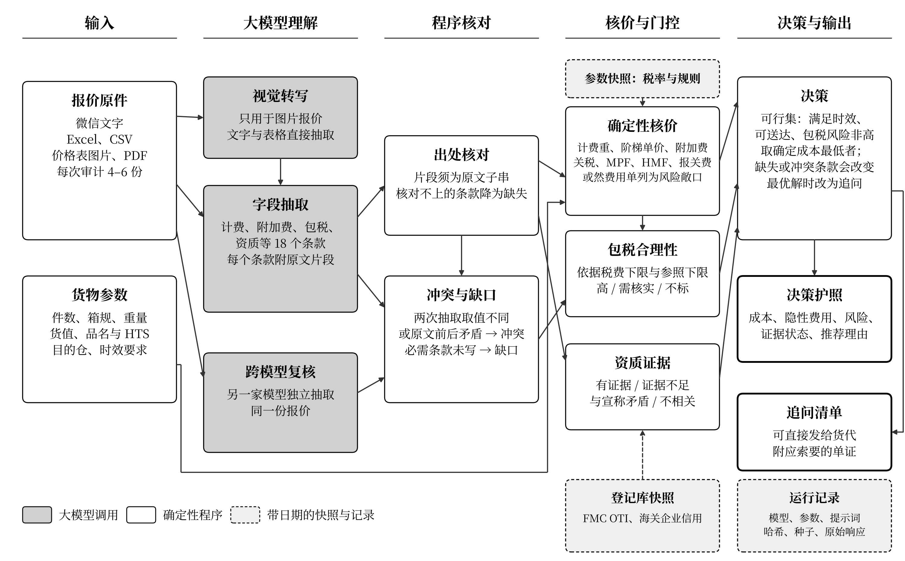
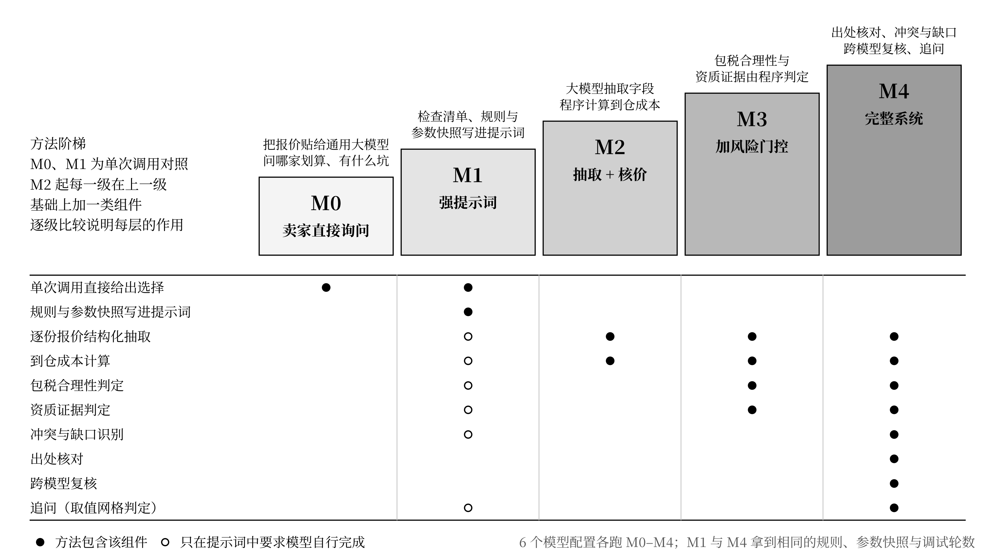
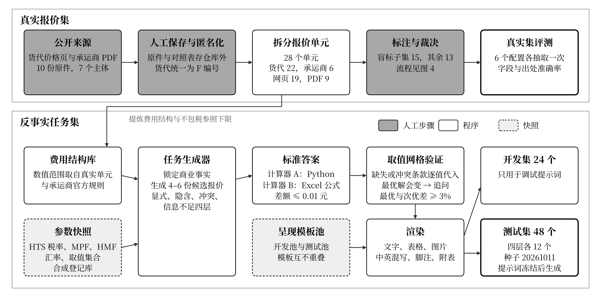
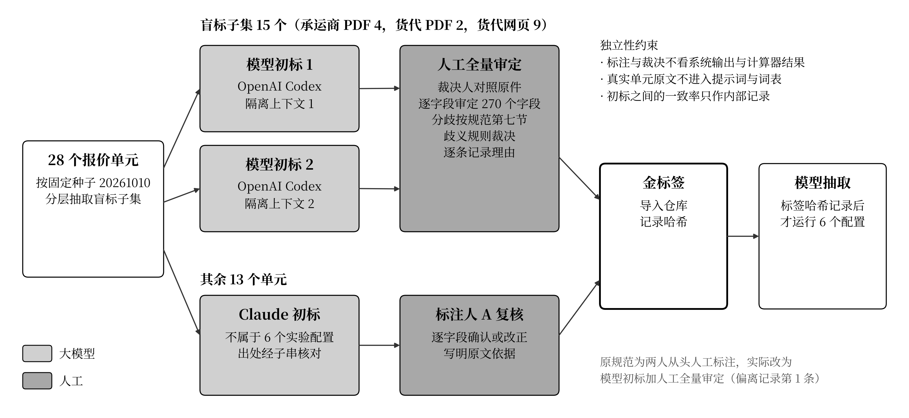

# 运价明镜：跨境头程报价智能审计（QuoteGuard）技术方案

<!-- 初稿。〔待填：…〕标记正式实验或真实报价集结果出来后填写的位置，定稿前全部替换并删除本注释。图位路径相对本文件。 -->

## 作品简介

**问题**：中国跨境卖家向美国发头程货时，收到的报价以微信文字、Excel 和价格表图片为主，计泡口径、最低计费重、附加费和包税范围各家写法不同，隐性费用常写在脚注或“不含项目”里。2025 年以来美国小额豁免暂停、关税多次调整，低价包税报价的风险上升。卖家可以直接使用的最简便的 AI 做法，是把报价贴给通用大模型问“哪家划算”。

**方案**：运价明镜把多模态报价抽取为带原文出处的结构化条款，用两套独立实现交叉核对的确定性计算器折算到仓成本，按事前写定的规则判定包税风险与资质证据状态，经跨模型复核标出冲突与缺口；信息不足时不作推荐，生成可以直接发给货代的追问清单，最后输出可核对的决策护照。

**效果**：在 48 个事前冻结的反事实测试任务和 28 个真实报价单元上，以通用大模型直接询问为对照，6 个模型配置合并后，48 个反事实测试任务上决策正确率〔待填〕、风险项检出 micro-F1〔待填〕、每百票少付〔待填〕元（合成任务估算），低成本模型加完整系统〔待填：主终点 3 结论〕；28 个真实报价单元上条款抽取字段准确率〔待填〕。

**应用**：可独立使用，也可作为卖家 ERP 插件或货代比价平台的报价审核模块；税率与规则以带日期的参数快照维护。

<!-- 简介定稿时压缩到 300 字以内。 -->

## 一、作品概述

### 1.1 背景

头程物流指从国内仓到美国亚马逊 FBA 仓或海外仓的干线运输与清关。头程报价由货代以非结构化方式给出：一份微信文字报价可能把计泡系数写在正文、把住宅派送费写在附表、把“关税实报实销”写在末尾备注。同一家货代的空派按体积重除以 6000 计泡，快递渠道按除以 5000 计泡，两份报价的单价无法直接比较。

2025 年至 2026 年，美国进口规则多次变化：小额豁免暂停，IEEPA 关税停征，第 122 条临时关税开征后到期，新的 301 关税叠加在原有对华 301 关税之上。规则变化使“双清包税”报价的定价依据随之变化，过低的包税价格可能意味着低申报，而卖家在由本人担任进口商（IOR）时要承担申报责任。

### 1.2 目标定位

运价明镜面向中国跨境卖家，以亚马逊 FBA 卖家为主，审计向美国发头程货时收到的快递、空派、海派包税专线报价。系统完成五件事：

1. 把不同口径的报价折算为同一批货的可比到仓成本；
2. 找出隐性费用和前后矛盾的条款；
3. 核查包税报价的价格是否覆盖应缴税费，以及资质宣称是否有登记库依据；
4. 信息不足以作出确定推荐时，生成追问清单；
5. 输出一份逐项可核对的决策报告（决策护照）。

作品对应赛道官方方向四“多仓协同物流与合箱优化”，同时涉及方向三“关税与贸易政策变动预警”“账号健康与合规风控助手”与方向二“跨境报关单据自动生成与校验工具”。

### 1.3 主要工作与贡献

1. **大模型与确定性规则的混合审计流程**：大模型负责多模态报价的条款抽取与原文定位，费用折算、包税判定、资质判定和决策由确定性程序完成，每一步都可复算。
2. **可校准的拒答与追问**：用取值网格判定缺失或冲突的条款是否会改变最优选择，只在会改变时拒绝推荐并追问，避免“信息一缺就拒答”。
3. **可复算的评测集**：72 个反事实发货任务（全部提示词冻结后生成测试集 48 个，生成后不再调整任何方法）与 28 个真实公开报价单元，标准答案由两套独立实现的计算器交叉核对生成。
4. **事前冻结的对照实验**：6 个国产大模型配置，方法阶梯 M0–M4 逐层消融，以通用大模型直接询问（M0）为对照；三个主终点、统计方法和结果解读规则在实验前写入协议并记录哈希。

与最接近的工作相比（表 3-1），本作品的差异集中在四点：条款级的原文出处并由程序核对；以“最优选择是否改变”为可计算条件的拒答与追问；两套独立实现交叉核对的计算器作为标准答案来源；在冻结协议下以方法阶梯逐层消融，分别度量提示、计算、门控与复核各自的作用。

## 二、需求分析

需求分析采用文献与官方统计、政策文本梳理、市场报价分析、现有工具对照和对照实验五种方法。对照实验中的 M0 组复现卖家把报价直接交给通用大模型的用法，其结果见第五章。

### 2.1 问题剖析

**（1）纠纷集中在运费，目的地以美国为主。** 宁波海事法院 2024 年 11 月发布的白皮书统计了 2021 年至 2024 年 6 月结案的跨境电商物流案件，共 400 件，标的额 1.58 亿元。争议焦点中代理运费占 79.3%，目的港为美国的占 74.5%；这类案件占该院货代与多式联运案件的比例由 9.8% 升至 52.2% [1]。

**（2）规则频繁变化，报价口径随之混乱。** 表 2-1 列出 2025 年以来与头程报价直接相关的规则变化，税率与生效日期以 USITC HTS 2026 Revision 20 与 Federal Register 原文为准。

表 2-1 2025–2027 年美国进口规则的主要变化

| 日期 | 变化 | 依据 |
|---|---|---|
| 2025-08-29 | 暂停所有国家的小额豁免 | 白宫行政令（2025-07-30）[5] |
| 2026-02-20 | 最高法院判定 IEEPA 关税无效，CBP 自 2026-02-24 起停征 | 最高法院判决 [6] |
| 2026-02-24 至 2026-07-23 | 第 122 条临时关税，加征 10%（HTS 9903.03.01） | 91 FR 9339 |
| 2026-07-24 起 | 新 301 关税对中国产品加征 12.5%（HTS 9903.05.31），与原有对华 301 关税叠加 | 91 FR 47318；HTS 第 99 章 U.S. note 52(a) |
| 持续有效 | 原有对华 301 关税 | 91 FR 64212 [3] |
| 持续有效 | 232 关税（本作品选品避开 232 商品） | HTS 第 99 章 [2] |
| 2026-10-08 | CBP 发布 Low-Value Shipments 拟议规则，修改货值 2,500 美元以下非正式报关的申报要求 | 91 FR 64532 |
| 2027-07-01 起 | 小额豁免在法律上永久废除 | 〔待核：法律条文〕 |

以本作品选用的四类商品为例，2026-07-24 之后的合计税率（MFN、原 301 与新 301 之和）由 12.5% 到 55.1% 不等（见 4.3.3 节表 4-4）。同一份包税报价在规则变化前后的盈亏完全不同，卖家仅凭单价无法判断报价是否覆盖应缴税费。

**（3）执法收紧，低申报的后果转向卖家。** 截至 2025 年 12 月，CBP 已对 2.46 亿多件原免税小包征税超过 10 亿美元 [7]。2026 年卖家社区报道了 5H、9H 扣货，以及卖家因低申报被要求补交多票单证的案例 [8]。卖家本人担任进口商时，按 19 USC 1592 承担申报责任。

**（4）报价本身含隐性费用和不可比口径。** 公开的包税报价通常把查验产生的仓储或滞港费、扣货损失、私人住宅派送费、高货值加价列为“不含” [9]。货代空派、海派多按除以 6000 计泡，快递按除以 5000 或 139 立方英寸每磅计泡。

**（5）卖家感知。** Jungle Scout 2025 年卖家调研中，38% 的卖家把运费上涨列为主要挑战 [10]。该调研样本覆盖全球卖家，不专指中国卖家。

### 2.2 市场报价分析

项目组从公开、无需登录的货代价格页与承运商价卡中整理出 10 份原件、28 个报价单元（单元定义见 4.3.1 节），来自 5 家货代与 2 家国际快递承运商。表 2-2 按报价形式与日期状态统计。

表 2-2 真实报价单元的报价形式与日期状态（28 个单元）

| 维度 | 分布 |
|---|---|
| 报价形式 | 分档价 16 个；起价 6 个；区间价 6 个 |
| 日期状态（相对采集日） | 在有效期内 16 个；已过期 6 个；无日期 6 个 |
| 发布方 | 货代 22 个（5 家）；承运商公布价 6 个（2 家） |
| 原件类型 | 网页 19 个；PDF 9 个 |

28 个单元中 12 个只给起价或区间价，且全部已过期或没有日期，卖家拿到这类报价时无法直接算出本票成本。真实单元中必需条款（计泡系数、最低计费重、有效期、不含项目、包税条款等）的缺失比例〔待填：全部标签导入后按规范第九节统计〕。

### 2.3 现有工具对照

表 2-3 现有工具与本作品的覆盖范围

| 工具 | 定位 | 中文非结构化报价 | 包税条款核查 | 资质核验 | 追问与拒答 |
|---|---|---|---|---|---|
| Freightos | 国际货运比价与订舱平台 | 否，结构化运价 | 否 | 否 | 否 |
| 亚马逊 AGL | 亚马逊官方头程服务 | 否，自家运价 | 否 | 否 | 否 |
| 5688 运价 API | FBA 头程运价查询接口 | 否，结构化运价 | 否 | 否 | 否 |
| Flexport MCP | 大模型可调用的运价与订舱接口 | 否，只查自家运价 | 否 | 否 | 否 |
| CostClaw | 海运报价归一与发票审核 | 英文海运进口商场景 | 否 | 否 | 否 |
| 通用大模型对话 | 卖家把报价贴给模型询问 | 是 | 依提示而定 | 无登记库依据 | 无校准 |
| 运价明镜 | 头程报价审计 | 是，文字、表格、图片 | 是，事前规则 | 是，登记库快照 | 是，取值网格判定 |

工具信息来自各工具官网与公开报道（核查日期 2026-10-09）[11]。上述平台提供结构化报价或订舱，包税条款只写在自由文本里，平台本身不解读。通用大模型能读自由文本，但缺少计算规则、登记库依据和拒答标准。

### 2.4 需求归纳与设计要求

| 需求 | 证据 | 设计要求 |
|---|---|---|
| 不同口径报价可比 | 计泡口径不一；起价、区间价、分档价混用 | 统一条款结构，确定性计算到仓成本，每个费用行项可追溯 |
| 发现隐性费用与矛盾 | 运费纠纷占 79.3%；不含项目写在备注 | 抽取正文、脚注与附表中的全部费用，标出两处写法不同的条款 |
| 判断包税报价是否合理 | 关税多次变化；低申报执法收紧 | 用带日期的税率快照计算税费下限，三档判定，列出应索要的单证 |
| 核验资质宣称 | 货代以执照、认证作为信任依据 | 宣称与登记库快照比对，区分有证据、证据不足、矛盾、不相关 |
| 信息不足时不误导 | 报价常缺必需条款 | 判断缺失条款是否改变最优选择，改变时追问 |
| 结论可核对 | 卖家与货代之间的纠纷需要依据 | 每个字段保留原文出处，输出决策护照 |

## 三、AI 技术工具选择与运用

### 3.1 相关工作与对比

**文档理解与信息抽取。** 版面感知的预训练模型（如 LayoutLM）与文档视觉问答（DocVQA）把表格、票据类文档的抽取作为监督学习任务，需要按版式标注训练数据。头程报价的版式由每家货代自定，同一家货代的微信文字、Excel 与图片版式也不同，难以积累统一版式的训练集。本作品用通用大模型做零样本抽取，并要求每个字段给出原文片段，用程序核对片段确实存在于原文。

**大模型与外部程序结合。** PAL 把算术推理交给程序解释器执行，Toolformer、ReAct 让模型在推理中调用工具。这类工作表明，计算交给确定性程序比让模型直接给数更可靠。本作品沿用这一分工：模型只负责理解条款，计费重、阶梯匹配、税费与决策全部由计算器和规则完成，模型不输出任何金额。

**引用与可核对性。** ALCE 等工作要求模型为生成内容附引用，并评估引用是否支持结论。本作品把引用落实到字段级：每个条款记录原文片段，片段在原文中找不到时该条款降为缺失，出处准确率作为独立指标报告。

**拒答与选择性预测。** 选择性分类在置信度不足时拒绝预测；面向大模型的拒答研究讨论模型何时应回答“不知道”。信息检索中的澄清问题研究则把“提问”作为对不确定输入的正面回应。本作品的拒答依据是一个可计算的条件：缺失或冲突的条款在其取值集合内变化时，最优报价是否改变。拒答与追问因此可以对照标准答案计分，误拒率与正确拒答率分开报告。

**模型自检与交叉验证。** 自一致性（self-consistency）对同一问题多次采样取多数；Chain-of-Verification 让模型生成验证问题自查；也有研究指出，模型在没有外部反馈时难以自行纠正推理错误。本作品的复核使用另一家厂商的模型独立抽取同一报价，两次取值不同的条款记为冲突，交由确定性规则处理，复核结论不依赖任一模型的自我判断。

**与本作品最接近的应用。** 2.3 节列出的运价平台提供结构化运价或订舱，CostClaw 做英文海运报价归一与发票审核。表 3-1 归纳差异。

表 3-1 本作品与相关方法的对比

| 方法 | 输入 | 计算 | 风险与证据 | 拒答 | 可核对性 |
|---|---|---|---|---|---|
| 版面抽取模型 | 固定版式文档 | 无 | 无 | 无 | 依赖标注框 |
| 程序辅助推理（PAL 类） | 文本问题 | 程序执行 | 无 | 无 | 程序可复算 |
| 通用大模型对话（M0） | 任意 | 模型直接给数 | 模型自由判断 | 无校准 | 无出处 |
| 结构化运价平台 | 结构化运价 | 平台计算 | 无 | 无 | 平台内 |
| 运价明镜（M4） | 中文文字、表格、图片 | 双实现计算器 | 事前规则与登记库快照 | 取值网格判定 | 字段级出处与原始记录 |

### 3.2 技术路线与选型依据

系统采用“大模型抽取，规则计算与判定”的混合路线，依据有三点：

1. **金额必须可复算。** 头程成本涉及计费重取整、阶梯匹配、最低计费重、燃油按运费计、关税按货值计等规则，任何一步出错都直接变成多付的钱。确定性计算器的结果可以由第二套独立实现与人工手算核对，模型直接给出的金额无法这样核对。
2. **判定规则需要事前固定。** 包税风险三档和资质证据四种状态都写成规则并在测试集生成前冻结，同一份报价在任何模型配置下得到同一判定口径，结果差异只来自抽取。
3. **理解非结构化条款需要大模型。** 报价的写法千差万别，条款可能在正文、脚注、附表或图片中，规则模板无法覆盖。大模型负责把这些写法映射到统一字段，并给出原文片段。

在此基础上，系统用跨模型复核弥补单一模型的漏抽，用取值网格把“信息不足”变成可计算的判断。

### 3.3 模型与平台选型

**选型原则。** 选用国内可直接访问、兼容 OpenAI 接口、有公开价格的国产大模型，覆盖三家服务商，便于卖家在国内合规使用，也便于他人复现。模型分两档：强模型档检验“更强的模型直接使用能否做对”；低成本档检验“低成本模型加完整系统”能否达到强模型直接使用的水平，并给出每次审计的成本。

表 3-2 实验使用的 6 个模型配置

| 配置 | 档位 | 服务商 | 模型名（2026-10-10 各服务商 /models 列表） | 图片转写模型 | M4 复核方 |
|---|---|---|---|---|---|
| ds_pro | 强 | DeepSeek 官方 | deepseek-v4-pro | deepseek-flash | qwen_max |
| qwen_max | 强 | 阿里云百炼 | qwen3.8-max-0902 | qwen3-vl-plus | ds_pro |
| glm | 强 | 硅基流动 | zai-org/GLM-5.3 | zai-org/GLM-4.5V | kimi |
| kimi | 强 | 硅基流动 | Pro/moonshotai/Kimi-K2.6 | Kimi-K2.6 自身 | glm |
| ds_flash | 低 | DeepSeek 官方 | deepseek-flash | deepseek-flash | qwen_plus |
| qwen_plus | 低 | 阿里云百炼 | qwen-plus | qwen3-vl-plus | ds_flash |

另设 ds_flash_think 组（deepseek-flash 开启思考模式），只运行 M1，对应卖家在网页端开启深度思考的用法。

**参数。** 温度为 0；Kimi-K2.6 与思考组 ds_flash_think 不设温度参数，使用服务商默认值，实际取值记入运行记录；除 ds_flash_think 外关闭思考模式。GLM-5.3 在两家服务商都不能关闭思考，使用允许的最小思考预算 thinking_budget = 1，并统计其推理 token；它是唯一带少量思考的配置，强模型档内比较时单独注明。输出上限为 M0 4000、M1 12000、抽取 2500、转写 1200 token。

**视觉输入。** 图片报价在所有方法中都先由本配置的视觉模型逐字转写为文字，转写结果作为该配置 M0–M4 的共同输入，方法之间的差异因此只来自文字推理。DeepSeek 两档共用 deepseek-flash 转写，千问两档共用 qwen3-vl-plus 转写，同厂商两档的差异只来自文字推理。第 0 步核实中，四个视觉模型对 1200×800 像素测试图都能正确转写，单图输入 token 为 615 至 1269。

**接口与记录。** 三家服务商都通过 OpenAI 兼容接口调用，适配器按服务商区分，默认流式传输。每次调用记录模型名、服务商、参数、提示词哈希、随机种子、原始响应、token 用量、费用与时延。

### 3.4 系统设计

图 3-1 运价明镜系统架构（图位，图由 docs/figures/ 提供）

系统由六个模块组成。

**（1）多模态输入与转写。** 输入为微信文字、Excel 或 CSV、价格表图片或 PDF。表格转为 Markdown 文本视图；图片由视觉模型按“从上到下、从左到右，每个表格行占一行，单元格用竖线分隔”的要求逐字转写。货物信息只用白名单字段（品名、运输方式、件数、箱规、货值、目的地代码与邮编、地址类型、是否偏远、时效要求、发运日期），按固定模板写成一段文字。

**（2）条款抽取与原文定位。** 每份报价调用一次抽取，输出 18 个条款：运输方式、重量档与单价、整票与单箱最低计费重、计泡系数、计重进位、附加费、燃油、包含项、不含项、包税条款（是否包税、包税范围、关税条款、进口商主体）、报关费、ISF 费、时效、有效期、赔付、资质宣称和报价主体。每个条款给出状态（明示、由表头推出、缺失、冲突）、取值和原文片段。出处核对模块把片段与原文都去除首尾空白、合并连续空白，并删除与中文字符相邻的空白（英文单词间的空格保留）后查找，片段全部找不到的条款降为缺失。附加费名称与资质类型由词表映射到内部代码，词表只来自开发池模板与事先写定的通用术语。

**（3）冲突与缺口识别。** 原文两处写法不同的条款记为冲突，例如正文写“双清包税”、备注写“关税实报实销”。必需条款没有写出记为缺口。必需条款按运输方式规定：所有运输方式为重量档、计泡系数、整票最低计费重、有效期、不含项、包税条款；快递另加燃油附加费，海运另加 ISF 费。

**（4）确定性核价。** 输入货物参数和报价条款，输出每票与每件的到仓成本。

- 计费重：每箱取实重、体积重（长×宽×高÷计泡系数）、单箱最低计费重三者最大值，按计重进位步长向上取整，乘箱数求和，再与整票最低计费重取大。
- 阶梯：取下限不超过计费重的最高一档，“21–44 / 45–99”类写法按连续区间理解。
- 成本构成：运费、附加费、燃油（按运费计）、关税、MPF、HMF（海运）、报关费、ISF 费（海运）。查验费、滞港费等或然费用单列为风险敞口，不计入确定成本。住宅派送费与偏远地区费只在地址条件满足时计入。
- 完税价格按货值计，不含国际运费；包税只免除报价写明的税项，其余税项由卖家另付。
- 每个费用行项先舍入到 0.01 元，总价为已舍入行项之和。

计算器有两套独立实现：A 为 Python 程序（十进制定点运算），B 为带公式的 Excel 工作簿，由 LibreOffice 重算后读回。两者按同一份书面规格分别编写，不共享计算逻辑。

**（5）风险与证据门控。**

包税合理性按三档判定：

- 税费下限 =（关税 + MPF，海运加 HMF）÷ 整票计费重，单位元/kg；
- 包税单价 = 报价自身的确定成本 ÷ 整票计费重；
- 高：包税单价低于税费下限，即报价连应缴税费都不够；
- 需核实：包税单价低于税费下限与不包税运价参照下限之和；
- 其余不标。

可行集排除“高”档报价，保留“需核实”档。标出风险时列出应当索要的单证：进口商主体（IOR）名称、CBP 7501 报关单、申报价值发票，海运另加 ISF 申报确认。

资质宣称（如“NVOCC”“海关高级认证”）与登记库查询快照比对（美国 FMC OTI 名单、中国海关企业信用公示平台），判为四种状态：有证据、证据不足、证据与宣称矛盾、证据与本次运输不相关。宣称未写管辖地时两库都查，任一库命中即有证据；空运或快递渠道援引海运执照、认证主体与报价主体不一致、以中国海关高级认证证明美国清关能力，判为不相关；国内交通运输部的无船承运备案与美国 FMC 执照分开判定。

**（6）跨模型复核、决策与追问。** 每份报价都由另一家厂商的模型独立抽取一次，两次取值不同的条款记为冲突；复核复用复核方在本任务上已有的抽取，不另发请求，复核方抽取与转写的费用计入被复核配置的单次审计成本。决策规则如下：

1. 可行集：满足时效约束、能送达目的仓、包税风险不为“高”；
2. 在可行集内选确定到仓成本最低者；
3. 对每个缺失或冲突的条款，在其有限取值集合上（多项同时缺失取笛卡尔积）逐一重算最优解，只要最优解改变，就不作推荐，改为追问，追问清单覆盖这些条款；
4. 可行集为空时追问。

追问清单按条款模板生成，可直接发给货代。决策护照汇总可比成本及其行项、隐性费用、风险项、证据状态、推荐理由或追问清单，每一项链接到原文出处。

### 3.5 方法阶梯

图 3-2 方法阶梯 M0–M4（图位）

表 3-3 方法阶梯与对应的现实做法

| 编号 | 方法 | 对应的现实做法 | 调用 |
|---|---|---|---|
| M0 | 卖家口吻直接询问：选哪家最划算、有什么坑 | 卖家可直接使用的最简便 AI 做法 | 每任务 1 次 |
| M1 | 强提示词：检查清单、计算与判定规则、参数快照、登记库快照 | “只改提示词够不够” | 每任务 1 次 |
| M2 | 大模型抽取条款，加确定性核价，按时效选最低成本 | “大模型加 Excel” | 每份报价 1 次抽取 |
| M3 | M2 加包税与资质门控 | 加规则引擎 | 复用 M2 抽取 |
| M4 | M3 加出处核对、冲突与缺口识别、跨模型复核、拒答与追问 | 完整系统 | 复用抽取与复核方抽取 |

M0 与 M1 末尾都要求单独输出一行固定格式的结论（选择或“需要追问”，加风险列表与追问问题），以便评分。M1 拿到与 M4 相同的检查清单、参数快照、取值范围和登记库快照，两者的提示词都在测试集生成前冻结，预试验之后都没有修改；预试验后修正的是 M2–M4 流水线中 4 类确定性的解析与归位错误（4.4.4 节）。M1 与 M4 的规则输入相同，差别在架构。M2、M3、M4 共用同一次抽取调用，三者的差异只来自下游的规则模块。

每一层回答一个问题：M1 对 M0 检验提示工程的作用；M2 对 M1 检验把计算交给程序的作用；M3 对 M2 检验风险门控的作用；M4 对 M3 检验原文定位、复核和拒答的作用。

## 四、项目实施

### 4.1 实施步骤、时间、资源与分工

表 4-1 实施步骤与时间

| 阶段 | 时间（2026 年） | 内容 | 产出 |
|---|---|---|---|
| 选题与方案 | 10-08 至 10-09 | 比赛要求核对、需求证据核实、方案定稿 | 最终方案 |
| 基础模块 | 10-09 至 10-10 | 数据结构、参数快照、两套计算器、模型适配器、执行器、统计工具 | 源码与单元测试 |
| 数据 | 10-10 | 真实报价采集、匿名化、单元清单与盲标名单；费用结构库与参照下限 | 真实报价集清单、费用结构库 |
| 评测集与方法 | 10-10 | 报价渲染器、门控与决策、任务生成器、M0–M4、评分与编排 | 开发集 24 个任务 |
| 预试验与冻结 | 10-10 | 接口核实 22 次调用、预试验 40 次调用；冻结协议；生成并冻结测试集 | 冻结协议与哈希、测试集 48 个任务 |
| 正式实验 | 10-11 至〔待填〕 | 三家服务商并行执行，补跑，组装与评分 | 原始记录、评分结果 |
| 真实报价集 | 10-12 至〔待填〕 | 标注与裁决、模型抽取、计分 | 金标签、准确率 |
| 材料 | 〔待填〕至 10-30 | 技术方案、演示系统与视频、答辩 PPT、佐证材料 | 提交材料 |

**资源。** 计算资源为云端开发容器与三家服务商的模型接口。正式实验总预算 300 元（含代金券与免费额度折算），现金支出只来自 DeepSeek。执行器按服务商分设上限：DeepSeek 官方 12 美元（现金）、阿里云百炼 140 元（免费额度，按官方标价折算）、硅基流动 100 元（代金券）。开发中使用 Claude Code 作为编码、代码审查与真实报价初标的辅助工具，它不属于 6 个实验配置，不参与任何被评测的输出。

**分工。**

| 成员 | 职责 |
|---|---|
| 项目负责人 | 方案设计、实验协议、结果解读、报告写作；实验预算审批 |
| 队员甲 | 真实报价采集与匿名化、单元选取依据；真实报价集裁决人，逐字段审定盲标子集 270 个字段 |
| 队员乙 | 真实报价集 13 个非盲标单元的逐字段复核 |

### 4.2 关键技术实现

全部代码位于 `src/quoteguard/`，共 20 个模块约 8,600 行 Python，测试约 6,800 行，正式实验前全量测试 645 项通过。表 4-2 列出模块。

表 4-2 主要模块

| 模块 | 功能 |
|---|---|
| schema、params | 报价条款、任务、标准答案的数据结构；带来源与哈希的参数快照 |
| calc_py、calc_xlsx | 两套独立实现的到仓成本计算器 |
| gate、decide | 包税三档与资质证据判定；可行集、最优解、追问判定、决策遗憾 |
| taskgen、render | 反事实任务与标准答案生成；文字、表格、图片三种形态的报价渲染及字段位置记录 |
| inputs、prompts | 面向模型的输入构造与落盘；提示词模板 |
| methods_llm、methods_pipeline | M0、M1 的请求与解析；M2–M4 的抽取、归一化、门控、出处核对、复核与追问 |
| locate、questions | 出处核对；追问清单 |
| llm、executor | 三家服务商的流式适配器；冻结计划执行器 |
| metrics、stats、orchestrate | 逐任务评分与主终点；统计检验；分阶段计划、组装、评分 |

**（1）两套计算器交叉核对。** 计算器 A 用 Python 十进制定点运算，计算器 B 生成带公式的 Excel 工作簿，由 LibreOffice 重算后读回。12 个手算案例与 40 组随机案例两套结果差额不超过 0.01 元；任务生成时对每个候选报价逐一核对，差额超过 0.01 元即报错，不以剔除代替修正。测试集 48 个任务的 238 个候选报价全部通过核对。

**（2）任务生成与渲染。** 生成器从费用结构库抽取运输方式与费用结构，按层级施加操作（隐性费用移入脚注或附表、条款两处写法不同、删除必需条款），用决策规则在取值网格上验证决定性与非决定性，不满足约束就重抽。渲染器把同一组商业事实写成聊天式文字、Excel 价格表或 PNG 图片（价格表或中性气泡样式，角落标“合成示例”），并记录每个字段在渲染结果中的位置（文字的字符区间、表格的单元格、图片的像素框），用于出处核对和转写准确率评分。开发池与测试池各有 9 个模板，措辞、版式、字段顺序、包税与资质表述互不重用。生成后对每个候选做端到端检查：冲突字段必须有两个出处，缺失字段必须没有出处，缺失或冲突的取值不能由其他字段推出。

**（3）门控与决策。** 包税三档与资质四态的判定函数同时用于 M3、M4 和标准答案生成，口径唯一。追问判定对缺失与冲突条款的取值做笛卡尔积，每个取值组合调用计算器重算最优解。

**（4）复核合并。** 复核合并时，两边都有值且不同记为冲突；必需条款一边缺失时保持缺失；可选费用一边缺失时按 0 比较。

**（5）可复现的执行。** 执行器读取冻结的调用计划，逐次记录每次尝试；支持批次锁、断点续跑、按服务商的预算硬上限（累计支出加在途上界超过上限即停批）、额度耗尽与余额不足停批、跨批次支出账本。流式传输下断流时保存已收到的内容。原始记录只追加，不改写。

### 4.3 数据与评测集

图 4-1 数据流程：真实报价单元提供费用结构与参照下限，生成反事实任务，冻结后执行与评分（图位）

数据分两部分：真实报价集用于评估真实场景下的抽取与缺口识别；反事实任务集提供带确定标准答案的决策任务。报告中所有数字分别标明来自真实数据还是合成数据。

#### 4.3.1 真实报价集

**计数单位。** 报价单元是同一份保存原件中，一个渠道对一个目的区域给出的一套价格与条款。一份原件最多取 3 个单元（按原文出现顺序），每个发布主体最多 6 个单元，承运商公布价最多 6 个单元并单列报告。

**纳入标准。** 原件已保存并记录 sha256；记录采集日期与原件可见的发布日期；目的地为美国、运输方式可识别；至少有一个可计算的计价项；来源公开可访问，无需登录，不是私聊或付费内容。没有原件、只有查价入口、原始出处无法核实的来源排除。历史价、起价、区间价、表头与数据列数不一致、前后条款矛盾的单元都纳入，按标注规则处理。

**构成。** 28 个单元，来自 10 份原件、7 个发布主体：货代单元 22 个（5 家货代，网页 19 个、PDF 3 个），承运商公布价单元 6 个（DHL 与 UPS 价卡各 3 个，PDF）。单元覆盖空派、海派（含海卡）与国际快递，目的区域按原文写法记录（如“美西”“邮编 8–9 开头”）。采集日期均为 2026-10-10。没有可用的独立图片价卡原件，图片模态只在反事实任务集中评估。

**匿名化。** 货代统一用 F 编号，网址在仓库中只写代号；仓库中只放匿名件，网页中的公司名、网址、电话、微信号、地址、统一社会信用代码替换为代号，PDF 中相应区域加黑框。原件、名称与网址对照表、登记库的真实名称查询记录由团队在仓库外保存。承运商的公开信息保留。

**标注格式。** 每个单元标注 18 个条款字段，每个字段记三项：状态（明示、由表头推出、缺失、冲突）、原文片段、归一化取值。百分数记小数，重量记 kg，金额保留原币种不换算；起价记起价数值，区间价记下限并备注上限。同一条款两处写法不同时记为冲突并记录两个值；表头与数据列数不一致时记两种对齐方式各自的档位；其他无法唯一确定的情况记缺失并写备注。

**标注流程。**

图 4-2 真实报价集标注流程（图位）

1. 用种子 20261010 按发布方类别与原件类型分层抽取 15 个单元作盲标子集（承运商 PDF 4 个、货代 PDF 2 个、货代网页 9 个；7 个发布主体、8 份原件），名单记录哈希后不再更改。
2. 盲标子集：两份初标在仓库外由大模型生成（〔待填：模型名称、日期，两份初标是否来自不同模型〕，不属于 6 个实验配置），裁决人对照原件逐字段审定全部 270 个字段（15 个单元 × 18 个字段），审定结果为金标签。这一流程替代了协议中标注人 A、B 各自从头人工标注的设计，记为协议偏离（4.6 节）。裁决人对每份初标的逐字段改正率在 5.7 节报告。
3. 其余 13 个单元由 Claude（Anthropic，2026-10-12，不属于 6 个实验配置）初标，队员乙逐字段复核。复核表逐字段给出“确认”或“改正”，改正项记录原文依据与理由。初标经独立核对：159 条出处全部是匿名件的子串。
4. 复核人与裁决人都不看系统在真实报价集上的输出、计算器结果或对方的标签。全部标签与裁决完成并记录哈希之后，才运行模型。

**用途与计分。** 6 个配置各对每个单元的匿名件做一次抽取（与 M2–M4 相同的抽取提示词，PDF 与网页正文按文字输入）。主结果为字段准确率：明示与推出字段要求状态一致且取值完全相等（数值按十进制比较，重量档逐档相等）；缺失字段要求系统给出缺失；冲突字段要求系统给出冲突且两个值的集合相等。出处准确率要求片段是匿名件的子串，且落在金标签出处的同一句或同一单元格内。缺口检出以必需条款中金标签为缺失的项为阳性。准确率的置信区间按原件整簇 bootstrap，因为同一原件、同一主体的单元共享模板。真实单元的原文不进入任何提示词或示例；费用结构库用到的单元与没用到的单元分开报告。

**不包税运价参照下限。** 包税“需核实”档需要一个不包税运价的参照下限，取自真实单元：纳入条件为货代、不包税、分档价、在有效期内、按 kg 计价；每个单元取最低一档单价，再在同一运输方式与目的区域内取最小值，美元按快照汇率换算。合格单元只有同一货代的 3 个标准空派单元，参照下限为美西 34.20、美中 35.62、美东 37.10 元/kg（5.08、5.29、5.51 美元/kg × 6.7330）。海运与快递没有合格单元，这两种运输方式不设“需核实”档，只判“高”或不标。

#### 4.3.2 反事实任务集

**设计思路。** 在商业事实锁定的前提下变换呈现方式，使每个任务都有唯一、可复算的标准答案。费用结构取自真实报价与承运商官方规则，呈现方式变换文字、表格或图片，中英混写，费用写在正文、脚注还是附表，包税表述，资质宣称及有无登记依据。

**规模与分层。** 72 个发货任务，开发集 24 个、测试集 48 个，每个任务 4–6 份候选报价。四个难度层级各占四分之一（表 4-3）。冲突层与信息不足层的测试任务中，每层 8 个为决定性（正确答案为追问）、4 个为非决定性（正确答案为推荐，用来测量误拒）。

表 4-3 难度层级

| 层级 | 情况 | 正确做法 | 测试集任务数 |
|---|---|---|---|
| 显式 | 条款全部写在正文 | 直接计算 | 12 |
| 隐含 | 至少一项影响最优解的费用写在脚注、附表或附加费表 | 找出隐含费用后计算 | 12 |
| 冲突 | 至少一个条款前后写法不同 | 识别冲突，按决策规则推荐或追问 | 12（决定性 8） |
| 信息不足 | 至少一个必需条款缺失 | 按决策规则推荐或追问 | 12（决定性 8） |

测试集 48 个任务共 238 份候选报价，其中文字 104 份、表格 74 份、图片 60 份；货物运输方式为海运 19 票、空运 15 票、快递 14 票；目的地覆盖 11 个 FBA 仓与 4 个非 FBA 收货地址（其中 8 票为住宅地址）；发运日期在 2026-10-12 至 2026-10-31 之间，晚于新 301 关税在途豁免的截止日。

**标准答案的定义（决策规则）。**

1. 可行集：满足任务的时效约束、能送达目的仓、包税风险不为“高”；
2. 在可行集内选确定到仓成本最低者；或然费用单列为风险敞口，不计入成本；
3. 缺失或冲突的条款在其取值集合内变化时，只要可行集内的最优解改变，正确答案就是追问，且追问清单必须覆盖该条款；可行集为空时正确答案为追问；条件式回答按追问计分；
4. 决策遗憾 = 所选报价的确定成本 − 最优报价的确定成本，以元/票和占最优成本的比例报告；选中可行集外报价的情况单独计数。

**防止捷径的约束。** 推荐类任务的最优解与次优解至少相差 3%，避免舍入误差翻转标签，决定性任务在取值网格的每个取值上都满足这一条。信息不足层的决定性与非决定性任务缺口数量分布相同，避免“缺口多就追问”的捷径。以包税条款为决定字段的决定性任务不超过该层决定性任务的 40%。报价未写税务条款时，即使能从价格水平推断是否包税，也按条款缺失处理。

**取值集合。** 计泡系数 {5000, 6000}；燃油附加费 {0, 10%, 20%}；报关费 {0, 150, 400} 元；ISF 费 {0, 200} 元；整票最低计费重 {0, 45, 100} kg；包税条款取不包税与三种包税范围；住宅、偏远、超尺寸、超重附加费各取低高两值。

**资质与登记库。** 反事实任务使用合成的登记库快照与合成主体名称（以“SYN-”开头），开发集与测试集主体互不重叠，全部标注为合成。场景包括有效执照、执照已注销、类型不符、空运援引海运执照、认证主体与报价主体不一致、未备案主体宣称交通部无船承运备案等。

**防泄露。** 面向模型的输入由独立模块构造，只读取渲染结果和白名单内的货物字段。层级、字段状态、费用位置、模板编号、种子、来源单元编号与标准答案都不进入模型输入；禁用词测试覆盖 layer、conflict、missing、gold、template 等 16 个词。图片报价只提供 PNG。

#### 4.3.3 参数快照

承运商规则、HTS 税率、MPF 与 HMF、汇率都记录来源、日期与哈希。MPF 按 FY2027 标准取值（正式报关按货值 0.3464%，最低 34.58 美元、最高 670.86 美元；非正式报关 2.77 美元，依据 91 FR 48398）；HMF 按货值 0.125%（仅海运）；汇率取中国外汇交易中心 2026-10-09 人民币对美元中间价 6.7330。选品避开 232 商品，四类商品的合计税率见表 4-4。

表 4-4 选用商品的税率（USITC HTS 2026 Revision 20）

| 商品 | HTS | MFN | 原 301 | 新 301 | 合计 |
|---|---|---|---|---|---|
| 棉制 T 恤 | 6109.10.00 | 16.5% | 清单 4A，7.5% | 12.5% | 36.5% |
| 塑料手机壳 | 3926.90.99 | 5.3% | 清单 4A，7.5% | 12.5% | 25.3% |
| 化纤旅行袋 | 4202.92.3131 | 17.6% | 清单 3，25% | 12.5% | 55.1% |
| 玩具 | 9503.00.00 | 免税 | 清单 4B，已暂停 | 12.5% | 12.5% |

第三类商品选用旅行袋（4202.92.3131），因为常见尺寸的化纤双肩包（4202.92.3120）在 2026-11-09 前有原 301 排除项，税率随尺寸变化。10 位统计号与原 301 产品排除项逐项核对，含 91 FR 56538 与 91 FR 64211 两份排除项修订。棉制品存在 UFLPA 扣留风险，作为或然风险列入，不计入确定成本。

### 4.4 实验设计

#### 4.4.1 三组实验

表 4-5 实验与指标

| 实验 | 问题 | 主要指标 |
|---|---|---|
| E1 报价理解与核价（主） | 能否算对真实到仓成本并作出正确决策 | 决策正确率（含正确追问）、字段准确率、出处准确率、核价误差、决策遗憾 |
| E2 风险与证据（主） | 能否识别隐性费用、包税风险和无依据的宣称 | 风险项检出 micro-F1、隐性费用召回率、冲突与缺口检出 F1、包税风险精确率与召回率、证据状态准确率、无依据宣称的采纳率 |
| E3 复核机制（辅） | 选择性复核值不值得 | 全部复核与只复核触发报价的复核比例、纠错数、决策正确率与成本 |

贯穿各实验的指标：信息不足任务的正确拒答率与不该拒答时的误拒率；追问清单对真实缺口的覆盖率；每次审计的调用成本与时延（千问免费额度按官方标价折算）。

**评分口径。** 决策正确：标准答案为推荐时，方法推荐且选择正确；标准答案为追问时，方法追问且追问条款至少覆盖一项应追问条款。风险项是（候选报价，类别，键）三元组，类别为隐性费用、冲突、缺口、包税风险；包税风险的阳性为“需核实”或“高”，只在包税等级已定的候选上计分。隐性费用只计召回，因为流水线无法区分费用写在正文还是脚注，误报只来自另外三类。M0、M1 的自由文本风险按事前冻结的费用类型词表映射为三元组，人工在隐去方法标签的条件下抽检 20%，报告映射一致率。

**调用失败的处理。** 调用最终失败（无有效观测、返回为空、抽取整份解析不出 JSON）对所有方法同样处理：该输出记为决策错误、风险项未检出，不从分母中剔除；失败数按配置与方法报告。

**E3 的设计。** 预试验中，金标签含风险的 14 份报价有 11 份因首次抽取漏抽而没有触发风险条件，只复核触发报价的方案无法发现这类漏抽，因此 M4 对全部报价复核。系统同时记录每份报价是否满足触发条件（冲突或缺口、包税风险、证据不足），“只复核触发报价”的变体 M4_trig 用同一批观测离线计算，作为 E3 的对照，不进入主终点。

#### 4.4.2 主终点与统计方法

分析单位是任务，配对设计，模型配置作为分层。三个主终点构成一个 Holm 族，族内总体 α = 0.05：

1. **E1 决策正确率**：M4 对 M0，非显式三层 36 个测试任务，6 个配置合并。统计量为合并后的准确率差。以任务为单位做置换检验：同一任务在全部配置中的 M0、M4 标签一起交换，保留任务内跨配置的相关；双侧。
2. **E2 风险项检出 micro-F1**：M4 对 M0，全部 48 个测试任务，6 个配置合并，统计量为 micro-F1 之差，置换方式同上；双侧。
3. **成本主张**：低成本档 M4 对同厂商强模型档 M0 的决策正确率（deepseek-flash 的 M4 对 deepseek-v4-pro 的 M0，qwen-plus 的 M4 对 qwen3.8-max-0902 的 M0，两对差值取均值），非显式 36 个任务。按任务整簇 bootstrap 做单侧非劣效检验，界值 −5 个百分点；Tango 检验作敏感性分析。

置换检验蒙特卡洛 99,999 次，bootstrap 9,999 次，种子 20261011。其余比较为次要结果，给出按任务整簇 bootstrap 的 95% 置信区间；二分类指标附 McNemar 精确检验，连续指标附配对置换检验，这些 p 值不做多重校正，只作描述。

**样本量。** 测试集规模由预算与时间确定：48 个任务 × 6 个配置 × 5 种方法，在 300 元总预算内完成。主终点合并 6 个配置并以任务为单位置换，36 个非显式任务对应 216 个配置与任务的配对观测；〔待填：按正式结果的方差报告可检出的最小差值〕。

#### 4.4.3 事前决策规则

结果解读规则在实验前写入协议，结果出来后按表执行，不临时改变主线。

表 4-6 事前决策规则

| 情况 | 处理 |
|---|---|
| 主终点 1 经 Holm 校正后不显著 | 主张收窄为“风险识别与追问”，决策正确率照实报告 |
| 主终点 2 经 Holm 校正后不显著 | 主张收窄为“核价与决策”，风险检出照实报告并做错误类型分析 |
| 主终点 3 未达到非劣效 | 成本主张改为“每个正确决策的调用成本”对比 |
| M0 在显式层的决策正确率 ≥ 90% | 成效以非显式三层和真实报价集为主 |
| M4 对 M2 的核价绝对误差差值，95% 置信区间包含 0 | 系统增量归于风险识别与追问 |
| M4 风险标记（冲突、缺口、包税风险）的精确率 < 0.7 | 报告精确率与召回率的权衡，给出阈值选择依据 |
| 思考模式组 M1 的决策正确率点估计 ≥ M4（同为 deepseek-flash） | 主张改为 M4 在成本、时延和可核对出处上的优势 |
| 真实报价集抽取字段准确率 < 0.8 | 照实报告，分析错误类型 |

#### 4.4.4 预试验、冻结与执行

**预试验。** 先用 22 次短调用核实各服务商的模型名、思考开关、随机种子与图片传入格式，再用 40 次调用在开发集 3 个任务上跑通全流程。预试验只检查流程，不作为结论。预试验据实确定了三项设计：M4 对全部报价复核（4.4.1 节）；M1 输出上限设为 12000 token（Kimi-K2.6 的 M1 输出用到 7618 token）；模型适配器采用流式传输（非流式长调用在约 30 秒处被网关中断）。

**冻结。** 冻结协议规定数据、配置、方法、终点、统计、执行与停止规则，协议本身、方案、规格、提示词、模型配置、费用结构库、参数快照、单元清单与盲标名单的 sha256 写入冻结记录。测试集在协议冻结之后生成，manifest 哈希与生成所用提交号追加到冻结记录。M0–M4 的全部提示词在测试集生成前冻结，只在开发集上调试；测试集生成后不查看标准答案调整任何方法、提示词、词表或阈值。

**执行规则。** 先运行全部图片转写，再运行 M0、M1 与抽取，保证同一配置各方法使用同一转写结果。每个配置、方法、任务调用 1 次。同一服务商连续 5 次失败时停批；额度耗尽、余额不足或预算到达上限时停批，排除原因后在同一批次目录续跑；批次结束后对仍无有效观测的请求补跑一次，仍失败的记为最终失败。原始记录不手工删改，不回填时间。

**调用规模。** 每个配置 M0 48 次、M1 48 次、抽取 238 次；三家服务商的转写分别为 60、60、120 次；思考组 M1 48 次；合计 2,292 次。费用按开发集外推的 2,348 次调用估算，点估计 140.5 元、上界 264.4 元。真实报价集另有 6 个配置 × 28 个单元的抽取调用。

### 4.5 评测的独立性控制

标准答案由本项目的规则定义，M4 又内置同一规则，评测需要排除“自己出题自己答”的优势。设计中的控制如下：

1. **区分规则与架构的作用。** M0 不知道本项目的计分约定（如或然费用不计入成本、条件式回答按追问计分），M4 对 M0 衡量的是规则与架构合起来的收益。M1 拿到与 M4 相同的规则与快照（3.5 节），M4 对 M1 单独衡量架构的作用，第五章与主终点并列报告这一比较。
2. **模板与测试集分离。** 开发池与测试池模板互不重用；全部提示词冻结后才生成测试集；归一化词表只来自开发池与通用术语，测试池写法上的词表覆盖率单独报告。
3. **标准答案独立核对。** 两套独立实现的计算器交叉核对全部候选报价，另有人工手算案例留档。
4. **真实数据检验泛化。** 真实单元的原文不进入任何提示词；用于提炼费用结构的单元与未用过的单元分开报告准确率。

### 4.6 协议偏离与执行记录

| 日期 | 事项 | 影响 |
|---|---|---|
| 2026-10-12 | 盲标子集的两份初标由大模型生成，替代标注人 A、B 的独立人工标注；金标签由裁决人对照原件逐字段审定全部 270 个字段 | 协议第八节要求的字段完全一致率与 Cohen's κ 不再报告；金标签的人工审定覆盖全部字段；改正率见 5.7 节 |
| 2026-10-12 | 正式实验执行中修正编排器生成计划时的一处报错：生成 B 阶段计划时重算 A 阶段计划，因预算按协议扣减后与原值不同而报错；修正后 A 阶段计划只差预算时不报错、不改写 | 计划内容与调用不变，新增测试覆盖 |
| 〔待填〕 | 〔正式实验与真实报价集运行中的其他偏离、停批与续跑〕 | 〔待填〕 |

## 五、应用成效

本章结果全部来自冻结协议规定的正式实验与真实报价集运行。决策类成效来自反事实任务，属于合成任务上的估算；抽取与缺口识别另有真实报价集的结果。

### 5.1 执行概况

表 5-1 正式实验执行概况

| 服务商 | 配置 | 计划调用 | 有效观测 | 补跑 | 最终失败 | 支出 |
|---|---|---|---|---|---|---|
| DeepSeek 官方 | ds_pro、ds_flash、ds_flash_think | 〔待填〕 | 〔待填〕 | 〔待填〕 | 〔待填〕 | 〔待填〕美元（现金） |
| 阿里云百炼 | qwen_max、qwen_plus、qwen_vl | 〔待填〕 | 〔待填〕 | 〔待填〕 | 〔待填〕 | 〔待填〕元（免费额度，按标价折算） |
| 硅基流动 | glm、glm_v、kimi | 〔待填〕 | 〔待填〕 | 〔待填〕 | 〔待填〕 | 〔待填〕元（代金券） |
| 合计 | | 2,292 | 〔待填〕 | 〔待填〕 | 〔待填〕 | 〔待填〕 |

〔待填：停批与续跑情况；截断（finish_reason 为 length）比例；GLM-5.3 推理 token 统计；图片转写准确率（按字符级编辑距离对照渲染原文，分视觉模型）。〕

### 5.2 E1：报价理解、核价与决策

**主终点 1。** 〔待填：一句话结论，含 6 个配置合并后 M4 与 M0 的决策正确率、差值、Holm 校正后 p 值。〕

表 5-2 决策正确率（非显式三层 36 个测试任务）

| 配置 | M0 | M1 | M2 | M3 | M4 |
|---|---|---|---|---|---|
| ds_pro | 待填 | 待填 | 待填 | 待填 | 待填 |
| qwen_max | 待填 | 待填 | 待填 | 待填 | 待填 |
| glm | 待填 | 待填 | 待填 | 待填 | 待填 |
| kimi | 待填 | 待填 | 待填 | 待填 | 待填 |
| ds_flash | 待填 | 待填 | 待填 | 待填 | 待填 |
| qwen_plus | 待填 | 待填 | 待填 | 待填 | 待填 |
| 合并（95% CI） | 待填 | 待填 | 待填 | 待填 | 待填 |

图 5-1 各层级、各方法的决策正确率，6 个配置合并（图位，灰度）

〔待填：显式层 M0 正确率，是否触发事前决策规则第 4 条。〕

表 5-3 决策正确率按报价模态分列（任务内含图片、表格报价与只含文字报价的任务分组，6 个配置合并）

| 任务分组 | M0 | M1 | M4 |
|---|---|---|---|
| 〔待填：分组口径〕 | 待填 | 待填 | 待填 |

**决策遗憾。** 〔待填：各方法每票多付金额与占最优成本比例；每百票多付金额；选中可行集外报价的比例。〕

**核价误差。** 〔待填：M2、M3、M4 在已定候选上的绝对误差与相对误差；M4 对 M2 差值的 95% CI，是否触发事前决策规则第 5 条。〕

**字段与出处。** 〔待填：反事实任务上抽取字段准确率、出处准确率、出处降级率，按模态（文字、表格、图片）分列；归一化词表在测试池写法上的覆盖率。〕

### 5.3 E2：风险与证据

**主终点 2。** 〔待填：一句话结论，含 M4 与 M0 的 micro-F1、差值、Holm 校正后 p 值。〕

表 5-4 风险检出（全部 48 个测试任务，6 个配置合并）

| 指标 | M0 | M1 | M2 | M3 | M4 |
|---|---|---|---|---|---|
| 风险项检出 micro-F1 | 待填 | 待填 | 待填 | 待填 | 待填 |
| 隐性费用召回率 | 待填 | 待填 | 待填 | 待填 | 待填 |
| 冲突与缺口检出 F1 | 待填 | 待填 | 待填 | 待填 | 待填 |
| 包税风险精确率 | 待填 | 待填 | 待填 | 待填 | 待填 |
| 包税风险召回率 | 待填 | 待填 | 待填 | 待填 | 待填 |
| 资质证据状态准确率 | 待填 | 待填 | 待填 | 待填 | 待填 |
| 无依据宣称的采纳率 | 待填 | 待填 | 待填 | 待填 | 待填 |

图 5-2 各方法风险项检出的精确率与召回率（图位，灰度）

〔待填：M4 风险标记精确率，是否触发事前决策规则第 6 条；M0、M1 自由文本映射的人工抽检一致率；错误类型分析。〕

### 5.4 拒答与追问

表 5-5 拒答与追问（冲突层与信息不足层，各 12 个测试任务）

| 指标 | M0 | M1 | M4 |
|---|---|---|---|
| 正确拒答率（决定性任务） | 待填 | 待填 | 待填 |
| 误拒率（非决定性任务） | 待填 | 待填 | 待填 |
| 追问清单覆盖率 | 待填 | 待填 | 待填 |

〔待填：按缺口数量（1 个、2 个）、缺口字段与运输方式分组的结果。〕

### 5.5 成本、时延与低成本模型

**主终点 3。** 〔待填：一句话结论，两对差值的均值、bootstrap 单侧下界、p 值，是否达到非劣效；Tango 敏感性分析结果。〕

表 5-6 每次审计的调用成本与时延

| 配置 | 方法 | 每任务调用数 | 每任务 token | 每任务成本（元） | 中位时延（秒） | 每个正确决策的成本（元） |
|---|---|---|---|---|---|---|
| 〔待填〕 | | | | | | |

**思考模式组。** 〔待填：ds_flash_think 的 M1 与 ds_flash 的 M4 对比，含成本与时延，是否触发事前决策规则第 7 条。〕

### 5.6 E3：复核机制

表 5-7 全部复核与只复核触发报价的对比

| 指标 | M4（全部复核） | M4_trig（只复核触发报价） |
|---|---|---|
| 复核比例 | 100% | 待填 |
| 复核发现的冲突数 | 待填 | 待填 |
| 有风险而未复核的报价数 | 0 | 待填 |
| 决策正确率 | 待填 | 待填 |
| 每任务成本 | 待填 | 待填 |

〔待填：结论与解读。〕

### 5.7 真实报价集

**结论。** 〔待填：一句话结论，6 个配置的字段准确率范围，是否触发事前决策规则第 8 条。〕

表 5-8 真实报价集抽取结果（28 个单元，置信区间按原件整簇 bootstrap）

| 配置 | 字段准确率 | 出处准确率 | 缺口检出召回率 | 缺口检出精确率 |
|---|---|---|---|---|
| 〔6 个配置〕 | 待填 | 待填 | 待填 | 待填 |

〔待填：按字段、按发布方类别（货代与承运商单列）、按原件类型、按是否用于费用结构库分列的准确率；M4 复核合并后的冲突与缺失状态；裁决人对盲标初标、队员乙对 13 个单元初标的逐字段改正率；错误类型分析。〕

### 5.8 演示案例与决策护照

图 5-3 演示系统：上传三份报价后生成的决策护照（图位，界面截图保留原色，由演示系统提供）

〔待填：一个推荐类任务与一个追问类任务的端到端示例，展示抽取与出处、隐性费用、包税风险、资质状态、到仓成本对比、决策护照与追问清单；另给一个真实报价单元（匿名）的抽取、出处与缺口示例。〕

### 5.9 效益分析

〔待填：合成任务估算，以 M0 为对照。降本：每百票少付金额及占到仓成本的比例；风险：少漏的风险项数；效率：单票审计时延与调用成本，与人工逐份核算一票（估算）对比。写明估算口径与适用范围。〕

### 5.10 事前决策规则的执行情况

| 规则 | 判定结果 | 处理 |
|---|---|---|
| 主终点 1 是否显著 | 待填 | 待填 |
| 主终点 2 是否显著 | 待填 | 待填 |
| 主终点 3 是否非劣 | 待填 | 待填 |
| M0 显式层正确率 ≥ 90% | 待填 | 待填 |
| M4 对 M2 核价误差差值 CI 含 0 | 待填 | 待填 |
| M4 风险标记精确率 < 0.7 | 待填 | 待填 |
| 思考组 M1 ≥ M4 | 待填 | 待填 |
| 真实集字段准确率 < 0.8 | 待填 | 待填 |

## 六、总结与展望

### 6.1 总结

〔待填：结果出来后按事前决策规则写定的主张，三到五句。〕

### 6.2 伦理与合规

**数据来源。** 真实报价只取自公开、无需登录的价格页与承运商价卡，人工逐条记录，不批量抓取，原件与采集日期留档。报价为企业公开发布的价格与条款。

**匿名化。** 货代名称统一用代号，仓库与提交材料中只出现匿名件；真实名称对照表与登记库查询记录在仓库外保存。合成报价图片使用中性样式，不使用任何即时通讯产品的标识，并标注“合成示例”；合成主体名称以“SYN-”开头。

**系统的判断边界。** 系统只标出报价中的不一致与风险，并列出应当索要的单证，不判定货代是否违法。包税风险的判定规则、参照下限与登记库快照都带日期，可以复核。

**数据合规。** 卖家把报价交给大模型处理时，可以选用国内服务商接口或本地部署模型；本作品全部实验使用国内服务商。

**研究诚信。** 原始记录完整保存、不手工删改（4.4.4 节），协议偏离逐条列于 4.6 节，开发辅助工具在 4.1 节写明。

### 6.3 局限

1. **决策类成效来自合成任务。** 反事实任务的费用结构取自真实报价与官方规则，呈现方式与条款组合是合成的。快递渠道的费用结构为合成假设，海派价格以真实包税报价的价格下沿人工估计，空派档价用真实单元校准。真实报价集只评估抽取与缺口识别，不评估决策。
2. **真实报价集规模有限。** 28 个单元来自 10 份原件、7 个发布主体，同一原件的单元共享模板，彼此不独立；没有独立的图片价卡原件；近期分档的货代报价只有一个发布主体。
3. **参照下限只覆盖空运。** 海运与快递没有合格的不包税分档单元，这两种运输方式不设“需核实”档，包税风险只判“高”或不标。
4. **金标签的产生方式。** 盲标子集的初标由大模型生成，金标签依靠一名裁决人逐字段审定，审定可能偏向初标的写法，使字段准确率偏高；没有两名标注人独立人工标注的一致性数据。
5. **计算口径。** 快递常见的分段进位（21 kg 以下按 0.5 kg、以上按 1 kg）不在字段内，涉及的真实报价按第一段规则计算。
6. **登记库与资质。** 反事实任务的登记库快照是合成的；真实报价集的资质证据状态依赖不公开的名称对照表，只能由项目组复核。
7. **模型与运行。** 每个条件只调用 1 次，温度 0 不保证输出完全确定；GLM-5.3 带最小思考预算，Kimi-K2.6 使用服务商默认温度；千问的费用按官方标价折算。模型版本更新后结果会变化，原始响应与模型名已完整记录。
8. **词表泛化。** M2–M4 的归一化词表只来自开发池与通用术语，测试池中部分写法（如零值的另一种说法）读不到，这部分损失计入正式结果。

### 6.4 展望

**部署路径。** 作为卖家 ERP 的插件，在卖家录入询价结果时自动生成决策护照；作为货代比价平台的报价审核模块，在报价上架前检查必需条款是否齐全、包税价格是否覆盖税费。审计结果中的追问清单可以直接发给货代，缩短询价往返。

**规则更新机制。** 税率、MPF 与 HMF、汇率、承运商附加费都以带日期与来源哈希的参数快照维护，政策变化时替换快照即可，判定规则与模型提示词不需要改动。登记库查询结果按日期保存快照，系统读取快照。

**扩展方向。** 一是扩展到欧盟、英国等目的地，替换税率快照与进口规则（如欧盟 IOSS 与增值税规则）；二是扩展到海外仓尾程与退货渠道；三是持续积累真实报价，扩大参照下限的覆盖面，为海运与快递建立“需核实”档；四是把卖家对追问的回复接回系统，形成询价、追问、复审的闭环。

## 七、附录

### 7.1 数据与代码

| 内容 | 位置 |
|---|---|
| 源码与测试 | `src/quoteguard/`、`tests/` |
| 方案与规格 | `docs/plan/AIC_最终方案.md`、`docs/plan/任务生成规格.md`、`docs/plan/方法实现规格.md`、`docs/plan/真实报价集_口径与标注规范.md` |
| 冻结协议与哈希 | `docs/protocol/冻结协议.md`、`docs/protocol/冻结记录.md`、`docs/protocol/预算估算.md` |
| 反事实任务集 | `data/tasks/dev`、`data/tasks/test`（任务与面向模型的输入）；`data/gold/`（标准答案）；生成器配置 `data/taskgen/` |
| 参数快照 | `data/params/tariff_snapshot_2026-10-09.json` 及原始依据 `data/params/raw/` |
| 真实报价集 | `data/seeds/units.json`、`data/seeds/blind_subset.json`、`data/seeds/anonymous/`（匿名件）、标签与裁决〔待填：路径与哈希〕 |
| 原始调用记录 | `runs/`（每次调用的请求、原始响应、token、费用、时延）；支出账本 `runs/spend_ledger.jsonl` |

代码与数据放百度网盘，链接见提交材料。

### 7.2 冻结哈希

协议冻结提交 `19686e8b3d9d9be55ac598992f52f04885d79c15`；冻结协议 sha256 `29a08030798cf637400a338e821f4bb6cc74bde5450817d5fbc51966f3837ac8`；测试集 manifest sha256 `6f03325e22245359b9dba32c64449b75f2f70e8098bf2e926fc1ba4ccc8561af`（生成所用提交 `b67f52285aeec4e7a6ae5b3d8359a9b43e0f6d53`）。完整清单见 `docs/protocol/冻结记录.md`，可用 `python scripts/freeze_protocol.py --check` 核对。

### 7.3 提示词

M0、M1、抽取与转写的提示词原文见 `docs/plan/方法实现规格.md` 第四节与 `src/quoteguard/prompts.py`。

### 7.4 参考文献

**政策、统计与数据来源**

1. 宁波海事法院. 跨境电商物流案件审判白皮书[R]. 2024-11.
2. U.S. International Trade Commission. Harmonized Tariff Schedule of the United States (2026 Revision 20)[DB]. https://hts.usitc.gov/
3. Federal Register: 91 FR 9339（第 122 条临时关税）；91 FR 47318（新 301 关税）；91 FR 64212（对华 301 关税继续实施）；91 FR 56538、91 FR 64211（301 排除项修订）；91 FR 64532（Low-Value Shipments 拟议规则）；91 FR 48398（FY2027 海关用户费）.
4. 19 CFR 24.23（Merchandise Processing Fee）；19 CFR 24.24（Harbor Maintenance Fee）；19 USC 1592.
5. The White House. Suspending Duty-Free De Minimis Treatment for All Countries[EB/OL]. 2025-07-30；Continuing the Suspension of Duty-Free De Minimis Treatment for All Countries[EB/OL]. 2026-02.
6. K&L Gates. Summary: Supreme Court Decision on IEEPA Tariffs[EB/OL]. 2026-02-20.
7. Supply Chain 247. CBP collects $1 billion after de minimis exemption ends[EB/OL].
8. 雨果网. 美国清关扣货与低申报补税案例报道[EB/OL]. https://www.cifnews.com/article/173745 ，/183754 ，/185714
9. 包税专线报价“不含项目”示例[EB/OL]. https://www.hst56.com/news/business/6295.html
10. Jungle Scout. The State of the Amazon Seller 2025[R].
11. Freightos、亚马逊 AGL、5688 运价开放接口、Flexport AI 助手、CostClaw 官网与公开报道[EB/OL]. 核查日期 2026-10-09.
12. 中国外汇交易中心. 人民币汇率中间价公告[EB/OL]. 2026-10-09.
13. Federal Maritime Commission. Ocean Transportation Intermediary List[DB]. https://www2.fmc.gov/oti/
14. 中国海关企业进出口信用信息公示平台[DB]. http://credit.customs.gov.cn
15. UPS、DHL、FedEx 体积重与附加费公开规则[EB/OL].

**相关研究**

16. Xu Y, Li M, Cui L, et al. LayoutLM: Pre-training of Text and Layout for Document Image Understanding[C]. KDD, 2020.
17. Mathew M, Karatzas D, Jawahar C V. DocVQA: A Dataset for VQA on Document Images[C]. WACV, 2021.
18. Gao L, Madaan A, Zhou S, et al. PAL: Program-aided Language Models[C]. ICML, 2023.
19. Schick T, Dwivedi-Yu J, Dessì R, et al. Toolformer: Language Models Can Teach Themselves to Use Tools[C]. NeurIPS, 2023.
20. Yao S, Zhao J, Yu D, et al. ReAct: Synergizing Reasoning and Acting in Language Models[C]. ICLR, 2023.
21. Gao T, Yen H, Yu J, Chen D. Enabling Large Language Models to Generate Text with Citations[C]. EMNLP, 2023.
22. Geifman Y, El-Yaniv R. Selective Classification for Deep Neural Networks[C]. NeurIPS, 2017.
23. Wen B, Yao J, Feng S, et al. Know Your Limits: A Survey of Abstention in Large Language Models[J]. TACL, 2025.
24. Aliannejadi M, Zamani H, Crestani F, Croft W B. Asking Clarifying Questions in Open-Domain Information-Seeking Conversations[C]. SIGIR, 2019.
25. Wang X, Wei J, Schuurmans D, et al. Self-Consistency Improves Chain of Thought Reasoning in Language Models[C]. ICLR, 2023.
26. Dhuliawala S, Komeili M, Xu J, et al. Chain-of-Verification Reduces Hallucination in Large Language Models[C]. Findings of ACL, 2024.
27. Huang J, Chen X, Mishra S, et al. Large Language Models Cannot Self-Correct Reasoning Yet[C]. ICLR, 2024.

**统计方法**

28. Holm S. A Simple Sequentially Rejective Multiple Test Procedure[J]. Scandinavian Journal of Statistics, 1979, 6(2): 65–70.
29. McNemar Q. Note on the Sampling Error of the Difference between Correlated Proportions or Percentages[J]. Psychometrika, 1947, 12(2): 153–157.
30. Tango T. Equivalence Test and Confidence Interval for the Difference in Proportions for the Paired-Sample Design[J]. Statistics in Medicine, 1998, 17(8): 891–908.
31. Efron B, Tibshirani R J. An Introduction to the Bootstrap[M]. Chapman & Hall, 1993.
